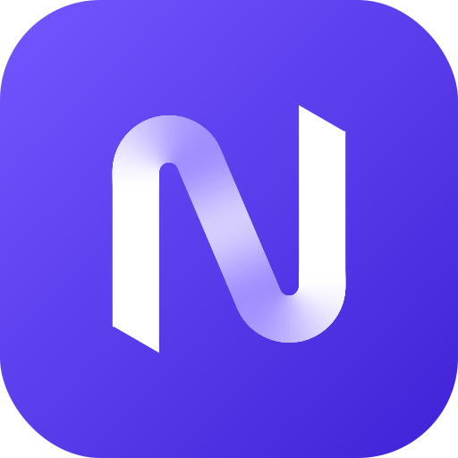
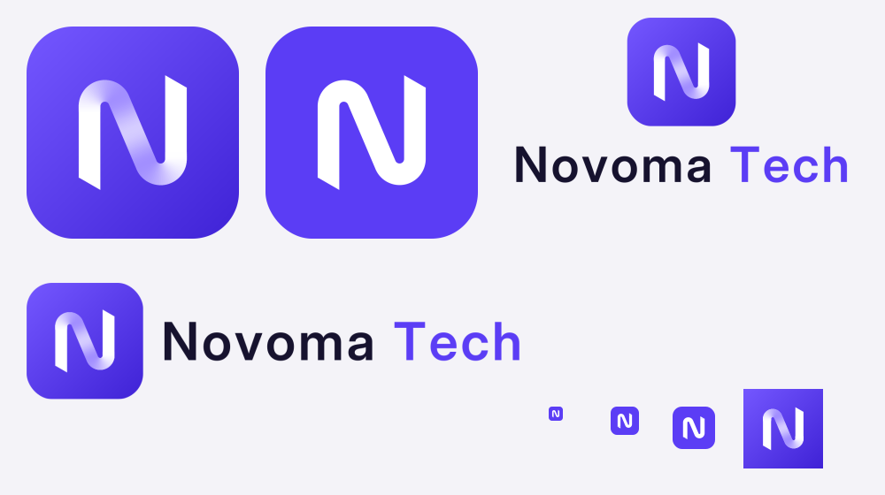
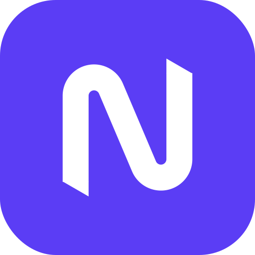

<!-- README public de l organisation NovomaTech -->

<picture>
  <source media="(prefers-color-scheme: dark)" srcset="https://raw.githubusercontent.com/NovomaTech/.github/main/profile/assets/novoma-horizontal-white-1200.png">
  
</picture>

### Studio de SaaS. On conçoit, on lance, on enchaîne.

---

## ⚡ Qui on est

**Novoma Tech** est un studio qui conçoit et lance **plusieurs SaaS**, à la chaîne et sans coupure.
Pas un produit unique : une **usine à produits** tech, pro et premium, où chaque nouveau lancement profite de tout ce qu'on a déjà construit.

<table>
<tr>
<td width="140" align="center">
  
</td>
<td>

**Le N en ruban.** Un ruban continu qui monte, se plie et remonte pour former un N.
C'est notre façon de travailler : un **flux de produits** qui ne s'arrête pas.
Relief lisse, extrémités biseautées, de l'élan dans chaque pli.

</td>
</tr>
</table>

## 🚀 Ce qu'on fait

| | |
|---|---|
| 🧪 **Concevoir** | Des SaaS pensés pour un vrai besoin, du premier croquis au produit fini. |
| 🛠️ **Construire** | Une base technique commune, réutilisée d'un produit à l'autre. |
| 📈 **Lancer** | Mise en ligne rapide, itérations courtes, produits qui vivent. |
| 🔁 **Recommencer** | Chaque produit nourrit le suivant. Le ruban continue. |

## 🎨 L'identité

  

| | Couleur | HEX |
|---|---|---|
|  | Violet Novoma | `#5B3DF5` |
|  | Violet lumière | `#7457FF` |
|  | Violet profond | `#3F22D6` |
|  | Lavande | `#A28FFF` |
|  | Encre | `#16122E` |

Typo : **Inter** (SemiBold pour les titres, Regular/Medium pour le texte).

 

**Novoma Tech** · on lance, on enchaîne.

